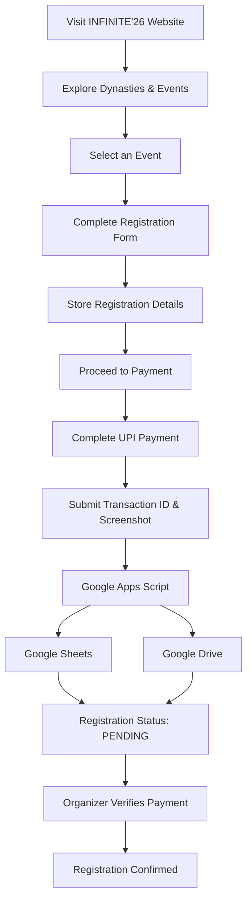

# INFINITE'26 — Cultural Fest Website

A web-based event discovery and participant registration platform developed for **INFINITE'26**, featuring a Japanese-inspired visual identity, four themed dynasties, event-specific registration, and an integrated payment submission and verification workflow.

## Overview

INFINITE'26 is a cultural fest platform designed to provide participants with a centralized interface to explore events, understand participation requirements, register for competitions, and submit payment details.

The platform combines a React-based frontend with Google Apps Script and Google Workspace services to handle registration data and payment verification.

## Key Features

- **Event Discovery:** Browse cultural and technical event categories, descriptions, participation rules, and registration fees.
- **Four Themed Dynasties:** Events organized under four Japanese-inspired dynasties — Kaze, Oto, Kokoro, and Yume.
- **Dynamic Event Pages:** Individual event pages with event-specific information and registration options.
- **Participant Registration:** Collect participant information through structured registration forms.
- **Payment Integration:** UPI-based payment workflow with transaction ID submission and payment screenshot uploads.
- **Registration Tracking:** Generate unique registration identifiers to distinguish individual submissions.
- **Payment Verification:** Maintain pending registrations until payment is verified by the organizing team.
- **Cloud-Based Data Management:** Store registration records in Google Sheets and uploaded payment screenshots in Google Drive.
- **Responsive Interface:** Designed to provide an accessible experience across desktop and mobile devices.

## Application Workflow

The application follows a multi-stage registration process:



## Technology Stack

| Layer | Technologies |
|---|---|
| Frontend | React.js, JavaScript |
| Build Tool | Vite |
| Routing | React Router |
| UI Icons | Lucide React |
| Backend Integration | Google Apps Script |
| Database / Records | Google Sheets |
| File Storage | Google Drive |
| Payment Method | UPI |
| Version Control | Git, GitHub |
| Deployment | Netlify |

## Project Structure

```text
infinite26/
├── public/
│   └── Static assets and media
├── src/
│   ├── data/
│   │   └── events.js
│   ├── pages/
│   │   ├── Registration.jsx
│   │   └── Payment.jsx
│   ├── App.jsx
│   └── main.jsx
├── index.html
├── package.json
└── vite.config.js
```

*The structure above highlights the principal application modules; other components and assets are omitted for brevity.*

## Getting Started

### Prerequisites

- Node.js (LTS recommended)
- npm
- Git

### Installation

Clone the repository:

```bash
git clone https://github.com/Unknownmib22/infinite26.git
```

Navigate to the project directory:

```bash
cd infinite26
```

Install dependencies:

```bash
npm install
```

Start the development server:

```bash
npm run dev
```

The application will be available at the local URL provided by Vite.

### Production Build

To generate an optimized production build:

```bash
npm run build
```

To preview the production build locally:

```bash
npm run preview
```

## Deployment

The project uses a GitHub and Netlify deployment workflow.

1. Source code is maintained in GitHub.
2. Changes are committed and pushed to the repository.
3. Netlify builds the application using Vite.
4. The production build is deployed and made accessible through the hosted website.

## Future Improvements

- Dedicated organizer dashboard for registration and payment management.
- Automated payment verification and registration status updates.
- Participant registration confirmation and notification system.
- Enhanced event analytics and participation reporting.

## Project Information

**Project:** INFINITE'26 Cultural Fest Website  
**Category:** Full-Stack Web Application  
**Repository:** [GitHub — INFINITE'26](https://github.com/Unknownmib22/infinite26)

---

Developed as a digital platform to streamline cultural fest event discovery, participant registration, and payment coordination.
